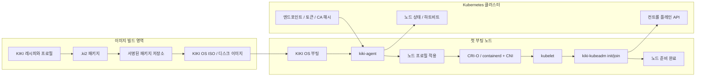

# KIKI OS 홈페이지 콘텐츠 기준

이 문서는 `dustbox.kr/kiki-os/` 하위 페이지와 추후 독립 KIKI OS 사이트에 반영할
소개 문구, 섹션 구성, 아키텍처 그림, 현재 상태 표기의 기준본이다.

## 핵심 포지셔닝

KIKI OS는 범용 서버 설치 미디어가 아니라 Kubernetes 노드 수명주기 자동화를 위한
재현 가능한 독립 배포판이다. `.ki2` 패키지, 루트 파일시스템, ISO, 설치기, 빌드 콘솔은
Kubernetes 자동화를 가능하게 하는 엔진룸으로 설명한다.

메인 메시지:

```text
KIKI OS
첫 부팅부터 Kubernetes 노드까지.
```

보조 문구:

```text
첫 부팅에서 노드 준비, 런타임 구성, 클러스터 조인까지 자동화합니다.
```

소개 문구:

```text
KIKI OS는 새 VM 또는 베어메탈 머신을 Kubernetes 노드로 바꾸기 위한 자동화 OS입니다.
ISO 또는 디스크 이미지로 부팅하면 네트워크 준비, 노드 프로필 적용, CRI 런타임 구성,
kubelet 실행, kubeadm 기반 클러스터 조인, 상태 보고까지 이어지는 흐름을 목표로 합니다.
```

## 첫 화면

첫 화면은 빌드 시스템보다 노드 자동화를 먼저 보여준다.

- 제목: `KIKI OS`
- 부제: `첫 부팅부터 Kubernetes 노드까지.`
- 설명: 새 머신을 Kubernetes 부트스트랩/컨트롤/컴퓨트 노드로 구성하는 OS
- 배지: `stage2-v2`, `Kubernetes 준비 기반`, `CRI-O 기본`, `containerd 선택`, `x86_64`
- 주요 링크: `GitHub`, `문서`, `2단계 상태`, `로드맵`

다운로드 버튼은 안정 릴리스 정책이 확정되기 전까지 보조 행동 버튼으로 둔다.

## 권장 섹션

1. 첫 화면
   - KIKI OS의 Kubernetes 자동화 목적을 한눈에 전달한다.
   - `.ki2`나 루트 파일시스템보다 `첫 부팅 -> 노드 준비 완료` 흐름을 전면에 둔다.

2. 첫 부팅에서 Kubernetes까지
   - ISO 또는 디스크 이미지 부팅
   - DHCP 또는 고정 IPv4 네트워크 준비
   - 역할별 노드 프로필 적용
   - CRI-O 또는 containerd 기반 kubelet 구성
   - kubeadm init/join 실행 준비
   - `kiki-agent` 상태 보고

3. 아키텍처
   - 이미지 빌드 영역, 첫 부팅 노드, Kubernetes 클러스터를 분리해서 보여준다.
   - 빌드 파이프라인은 "엔진룸"으로 배치한다.

4. 노드 프로필
   - `kiki-kube-bootstrap`
   - `kiki-kube-bootstrap-containerd`
   - `kiki-kube-control`
   - `kiki-kube-control-containerd`
   - `kiki-kube-compute`
   - `kiki-kube-compute-containerd`

5. 현재 상태
   - 2단계 V2 기준선을 명확히 표시한다.
   - 아직 자동화되지 않은 3단계 항목은 로드맵으로 분리한다.

6. 로드맵
   - 자체 빌드
   - `kiki-agent kube reconcile`
   - 원격 YAML 무인 설치
   - 공개키 기반 저장소 서명
   - CNI 명시 적용
   - 클러스터 운영 자동화

## 아키텍처 그림

홈페이지의 기본 아키텍처 그림은 다음 흐름을 사용한다.



짧은 설명:

```text
KIKI OS는 이미지 빌드와 노드 자동화를 분리합니다.
빌드 파이프라인은 재현 가능한 부팅 이미지를 만들고,
kiki-agent와 kiki-kubeadm은 첫 부팅을 Kubernetes 노드 등록 흐름으로 바꿉니다.
```

## 현재 상태 표기

홈페이지에는 다음 상태를 기준으로 표기한다.

- 릴리스 라인: `stage2-v2`
- 상태: 2단계 V2 기준선 완료, 2026-07-01 기준 동결
- 저장소 기본 채널: `stage2-v2`
- 최신 2단계 ISO 예시: `dist/iso/kiki-stage2-v2-installer-x86_64-20260711-rev9.iso`
- 최신 2단계 ISO sha256: `F4732724182765A1DC47B270255D9473078636A17957548BA281EBE89A902B06`
- 목표: 온라인/오프라인 패키지 설치, 무인 설치, Kubernetes 노드 준비 기반

완료된 2단계 내용:

- `ki2ctl` HTTP/로컬 미러/오프라인 저장소 흐름
- `.ki2` 패키지 저장소 메타데이터와 채널 생성
- HMAC-SHA256 기반 개발용 저장소 서명/검증
- 설치된 시스템 패키지 DB와 파일 충돌 탐지
- 1단계 설치기와 Go TUI의 설치 계획서 계약 공유
- Kubernetes 부트스트랩/컨트롤/컴퓨트 프로필
- CRI-O 기본 런타임과 containerd 선택 런타임
- `kiki-kubeadm` 기반 kubeadm 설정 렌더링과 init/join 보호 조건
- 빌드 웹 콘솔과 `stage2` 검증 파이프라인

3단계로 넘기는 항목:

- 실제 첫 부팅 경로에서 `kiki-agent kube reconcile` 연결
- 부트스트랩/컨트롤/컴퓨트 노드의 kubeadm init/join 자동화
- 토큰, CA 해시, 컨트롤 플레인 인증서 정책 분리
- CNI 매니페스트 명시 적용
- 원격 YAML 무인 설치 계획서 검증과 실행
- 공개키 기반 저장소 서명
- 자체 빌드와 패키지 업그레이드/롤백 정책

## 왜 Ubuntu가 아닌가?

방문자가 바로 궁금해할 질문이므로 별도 섹션으로 둔다.

답변 문구:

```text
Ubuntu 같은 범용 서버 OS는 넓은 용도에 맞춰져 있습니다.
KIKI OS는 Kubernetes 노드가 되기 위한 부팅, 설치, 패키지, 런타임, 조인 흐름을
처음부터 하나의 재현 가능한 수명주기로 다루는 것을 목표로 합니다.
```

## 라우팅과 메타데이터

초기 URL은 `dustbox.kr/kiki-os/`를 권장한다. 추후에는 `kiki.dustbox.kr` 또는
독립 도메인으로 이동할 수 있도록 페이지 title, OG image, 내부 링크를 KIKI OS 중심으로 둔다.

권장 메타데이터:

- title: `KIKI OS - 첫 부팅부터 Kubernetes 노드까지`
- description: `KIKI OS는 새 VM 또는 베어메탈 머신을 Kubernetes 노드로 바꾸기 위한 자동화 OS입니다.`
- og:title: `KIKI OS`
- og:description: `첫 부팅부터 Kubernetes 노드 준비까지 자동화합니다.`
- canonical: `https://dustbox.kr/kiki-os/`

`dustbox.kr/kiki-os/`는 VLab 포털 라우팅과 분리되어야 하며, KIKI OS 소개 페이지가
직접 렌더링되도록 설정한다.
