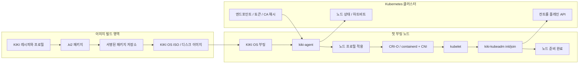

# KIKI OS 홈페이지 콘텐츠 기준

이 문서는 `dustbox.kr/kiki-os/` 하위 페이지와 추후 독립 KIKI OS 사이트에 반영할
소개 문구, 섹션 구성, 아키텍처 그림, 현재 상태 표기의 기준본이다.

## 핵심 포지셔닝

KIKI OS는 범용 서버 설치 미디어가 아니라 Kubernetes 노드 수명주기 자동화를 위한
재현 가능한 독립 배포판이다. `.ki2` 패키지, 루트 파일시스템, ISO, 인스톨러, 빌드 콘솔은
Kubernetes 자동화를 가능하게 하는 엔진룸으로 설명한다.

메인 메시지:

```text
KIKI OS
첫 부팅부터 Kubernetes 노드와 AI 관리까지.
```

보조 문구:

```text
첫 부팅에서 노드 준비와 승인형 온디바이스 AI 관리까지 연결합니다.
```

소개 문구:

```text
KIKI OS는 새 VM 또는 베어메탈 머신을 Kubernetes 노드로 바꾸기 위한 자동화 OS입니다.
ISO 또는 디스크 이미지로 부팅해 네트워크와 역할 프로필을 준비하고,
CRI 런타임·kubelet·kubeadm 기반 클러스터 조인으로 이어지는 흐름을 목표로 합니다.
Stage 3에서는 AI가 제안한 명령을 사용자가 검토·승인하는 로컬 관리 콘솔도 개발합니다.
실제 VM에서 클러스터 init/join까지 완료했다고 주장하지 않습니다.
```

## 첫 화면

첫 화면은 빌드 시스템보다 노드 자동화를 먼저 보여준다.

- 제목: `KIKI OS`
- 부제: `첫 부팅부터 Kubernetes 노드와 AI 관리까지.`
- 설명: 새 머신을 Kubernetes 부트스트랩/컨트롤/컴퓨트 노드로 구성하는 OS
- 배지: `Stage 3 개발 중`, `CLI / TUI / GTK`, `Ed25519`, `llama.cpp / GGUF`, `x86_64`
- 주요 링크: [`stage3` 소스](https://git.vlab.dustbox.kr/dustbox/kiki-os/src/branch/stage3), `개발 상태`, `다운로드 안내`

다운로드 버튼은 안정 릴리스 정책이 확정되기 전까지 보조 행동 버튼으로 둔다.

## 권장 섹션

1. 첫 화면
   - KIKI OS의 Kubernetes 자동화 목적을 한눈에 전달한다.
   - `.ki2`나 루트 파일시스템보다 `첫 부팅 -> 노드 준비 완료` 흐름을 전면에 둔다.

2. 첫 부팅에서 Kubernetes까지
   - ISO 또는 디스크 이미지 부팅
   - DHCP 또는 고정 IPv4 네트워크 준비
   - 역할별 노드 프로필 적용
   - CRI-O 또는 containerd 기반 kubelet 구성
   - kubeadm init/join 실행 준비
   - `kiki-agent` 상태 보고

3. 아키텍처
   - 이미지 빌드 영역, 첫 부팅 노드, Kubernetes 클러스터를 분리해서 보여준다.
   - 빌드 파이프라인은 "엔진룸"으로 배치한다.

4. 노드 프로필
   - `kiki-kube-bootstrap`
   - `kiki-kube-bootstrap-containerd`
   - `kiki-kube-control`
   - `kiki-kube-control-containerd`
   - `kiki-kube-compute`
   - `kiki-kube-compute-containerd`

5. 현재 상태
   - 2단계 V2는 이전 기준선, 3단계는 현재 개발 단계로 구분한다.
   - r18 ISO의 생성·정적 검증과 실제 VM 설치 검증을 구분한다.

6. 로드맵
   - 자체 빌드
   - `kiki-agent kube reconcile`
   - 원격 YAML 무인 설치
   - 서명 저장소의 실제 설치 전 신뢰 검증과 공개 배포
   - CNI 명시 적용
   - 클러스터 운영 자동화

## 아키텍처 그림

홈페이지의 기본 아키텍처 그림은 다음 흐름을 사용한다.



짧은 설명:

```text
KIKI OS는 이미지 빌드와 노드 자동화를 분리합니다.
빌드 파이프라인은 재현 가능한 부팅 이미지를 만들고,
kiki-agent와 kiki-kubeadm은 첫 부팅을 Kubernetes 노드 등록 흐름으로 바꿉니다.
```

## 현재 상태 표기 (2026-09-28)

홈페이지에는 검증 범위를 분리해서 표시한다.

- 이전 기준선: `stage2-v2` (2026-07-01 동결). 현재 개발 라인은 `stage3-v3`이다.
- 소스: [`stage3` 브랜치](https://git.vlab.dustbox.kr/dustbox/kiki-os/src/branch/stage3)에 개발 소스와 공개 서명 메타데이터를 올렸다. ISO, `.ki2` 바이너리, 서명 개인키는 Git에 없다.
- 패키지: 현재 선택한 x86_64 `.ki2` 116개의 SHA-256을 확인했다. Ed25519 서명 메타데이터가 저장소 인덱스의 해시를 고정하고, 인덱스가 패키지별 해시를 고정한다. 개별 `.ki2` 서명 파일을 만들었다는 뜻은 아니다.
- 커널과 헤더: `6.1.187` 고정.
- 개발용 설치 ISO: `kiki-stage3-v3-installer-x86_64-20260928-r18.iso` (4,154,300,416바이트, SHA-256 `19F586ED695BB9CA10FF8230819BB16883281F0674120A7F3BE981BBAC462BBC`). ISO 내부 manifest, 패키지 116개, 저장소 서명을 읽어 확인했다.
- 검증 경계: r18 ISO의 VM 부팅·설치와 설치 후 동작은 아직 확인하지 않았다. 공개 다운로드로 배포한 상태도 아니다. 개발용 ISO는 Secure Boot 서명 미적용이므로 Hyper-V 2세대 시험 시 Secure Boot를 꺼야 한다.
- 노드 자동화: Stage 3 설정 계층과 compute join dry-run은 자동 검증했다. 실제 bootstrap init 및 compute/control join은 VM 통합 검증 대상이다.
- 인스톨러/AI: GTK → 전체 화면 TUI → CLI 폴백과 승인형 로컬 AI 관리 흐름을 개발 중이다. 정적·자동 테스트를 실제 머신의 설치 성공으로 표현하지 않는다.

남은 작업은 r18 ISO의 GUI/TUI/CLI 설치·복구 경로, 네트워크, 로그인,
클러스터 init/join을 실제 VM에서 확인하고, 검증된 이미지의 공개 배포와
업그레이드·롤백 정책을 정리하는 것이다.

## 왜 Ubuntu가 아닌가?

방문자가 바로 궁금해할 질문이므로 별도 섹션으로 둔다.

답변 문구:

```text
Ubuntu 같은 범용 서버 OS는 넓은 용도에 맞춰져 있습니다.
KIKI OS는 Kubernetes 노드가 되기 위한 부팅, 설치, 패키지, 런타임, 조인 흐름을
처음부터 하나의 재현 가능한 수명주기로 다루는 것을 목표로 합니다.
```

## 라우팅과 메타데이터

초기 URL은 `dustbox.kr/kiki-os/`를 권장한다. 추후에는 `kiki.dustbox.kr` 또는
독립 도메인으로 이동할 수 있도록 페이지 title, OG image, 내부 링크를 KIKI OS 중심으로 둔다.

권장 메타데이터:

- title: `KIKI OS - 첫 부팅부터 Kubernetes 노드까지`
- description: `KIKI OS는 새 VM 또는 베어메탈 머신을 Kubernetes 노드로 바꾸기 위한 자동화 OS입니다.`
- og:title: `KIKI OS`
- og:description: `첫 부팅부터 Kubernetes 노드 준비까지 자동화합니다.`
- canonical: `https://dustbox.kr/kiki-os/`

`dustbox.kr/kiki-os/`는 VLab 포털 라우팅과 분리되어야 하며, KIKI OS 소개 페이지가
직접 렌더링되도록 설정한다.
